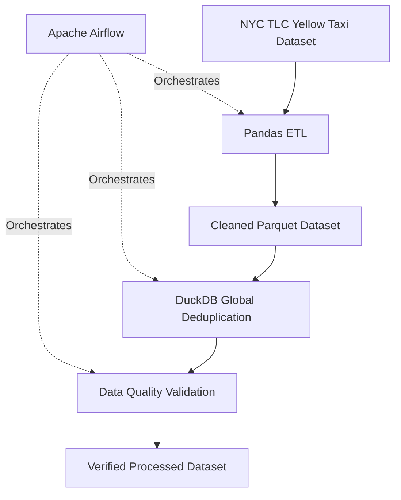
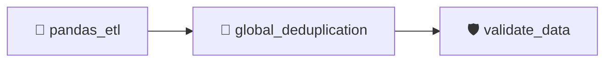

# 🚖 NYC Taxi Data Engineering Project


## 📌 Project Overview

This project implements an end-to-end data engineering pipeline using the **NYC TLC Yellow Taxi January 2025 dataset**.

The pipeline performs batch data processing, data cleaning, deduplication, data quality validation, and analytical SQL queries.

The project demonstrates practical implementation of data engineering concepts using Python, Pandas, PySpark, DuckDB, Apache Airflow, and Docker.

## 🏗️ Architecture



### 🔄 Airflow DAG Workflow



## 🎯 Project Objectives

- 📥 Process large-scale NYC Taxi trip data.
- 🧹 Clean invalid records and transform raw data.
- ⚡ Implement batch processing using Pandas and PyArrow.
- 🔥 Implement data processing using PySpark.
- 🦆 Perform global deduplication using DuckDB.
- 🛡️ Validate processed data using automated quality checks.
- 🔄 Automate ETL execution using Apache Airflow.
- 🐳 Run Airflow using Docker containers.
- 📊 Perform analytical queries using SQL.

## 📂 Dataset

**Source:** NYC Taxi & Limousine Commission (TLC)

**Dataset:** Yellow Taxi Trip Records – January 2025

- Format: Parquet
- Raw Records: 3,475,226
- Raw Columns: 20
- Processed Records: 3,473,175
- Processed Columns: 21

📥 Dataset: [NYC TLC Trip Record Data](https://www.nyc.gov/site/tlc/about/tlc-trip-record-data.page)

## 🛠️ Technologies Used

| Technology | Purpose |
|---|---|
| Python | Data processing and scripting |
| Pandas | ETL and data transformation |
| PyArrow | Batch processing and Parquet operations |
| PySpark | Distributed data processing implementation |
| DuckDB | SQL analytics and global deduplication |
| Apache Airflow | Workflow orchestration |
| Docker | Containerized Airflow environment |
| SQL | Analytical queries |
| Git & GitHub | Version control |

## ⚙️ ETL Pipeline

### 1️⃣ Data Inspection

- Inspect dataset structure.
- Identify column names and data types.
- Understand dataset characteristics.

### 2️⃣ Data Profiling

- Analyze missing values.
- Examine data distributions.
- Identify potential data quality issues.

### 3️⃣ Data Cleaning

- Remove records with invalid trip durations.
- Remove records with negative trip distances.
- Calculate trip duration.
- Transform and prepare dataset for analysis.

### 4️⃣ Batch Processing

- Process records in batches of 100,000.
- Use PyArrow Parquet readers and writers.
- Reduce memory consumption during processing.

### 5️⃣ Global Deduplication

- Perform global deduplication using DuckDB.
- Identify duplicate records across the complete processed dataset.
- Generate deduplicated Parquet output.

### 6️⃣ Data Quality Validation

- Verify record counts.
- Check duplicate records.
- Validate trip duration.
- Validate trip distance.
- Verify output dataset.

## 📊 ETL Results

| Metric | Result |
|---|---:|
| Raw Records | 3,475,226 |
| Processed Records | 3,473,175 |
| Records Removed | 2,051 |
| Processed Columns | 21 |
| Duplicate Records | 0 |
| Invalid Trip Duration | 0 |
| Negative Trip Distance | 0 |
| Output File Size | 75.06 MB |

### ✅ Data Quality

- ✔ Invalid trip durations removed.
- ✔ Negative trip distances removed.
- ✔ Global duplicate check completed.
- ✔ Final dataset validated successfully.
- ✔ Processed dataset ready for analytical queries.

## 🔥 PySpark Implementation

A separate PySpark ETL implementation is included to demonstrate data processing using Apache Spark.

The project also includes an ETL comparison script to compare processing implementations.

**Note:** PySpark ETL is implemented separately and is not currently part of the Airflow DAG.

## 🔄 Apache Airflow Orchestration

The Airflow DAG automates the following tasks:

1. `pandas_etl` – Execute Pandas ETL pipeline.
2. `global_deduplication` – Perform DuckDB global deduplication.
3. `validate_data` – Validate processed dataset.

All three tasks have been successfully executed through the Airflow DAG.

## 🦆 SQL Analytics

SQL queries are implemented using DuckDB.

### 📁 SQL Scripts

- `01_basic_analytics.sql`
- `02_daily_analytics.sql`

These scripts demonstrate analytical queries on the processed taxi dataset.

## 📁 Project Structure

```text
nyc-taxi-data-engineering/
│
├── dags/
│   └── nyc_taxi_etl.py
│
├── data/
│   ├── raw/
│   │   └── yellow_tripdata_2025-01.parquet
│   │
│   └── processed/
│       ├── yellow_tripdata_2025-01_cleaned.parquet
│       └── yellow_tripdata_2025-01_deduplicated.parquet
│
├── sql/
│   ├── 01_basic_analytics.sql
│   └── 02_daily_analytics.sql
│
├── src/
│   ├── inspect_dataset.py
│   ├── profile_dataset.py
│   ├── etl_pipeline.py
│   ├── etl_pipeline_backup.py
│   ├── verify_etl.py
│   ├── pyspark_etl.py
│   ├── compare_etl.py
│   ├── global_deduplication.py
│   ├── run_sql.py
│   └── run_daily_analytics.py
│
├── docker-compose.yaml
├── Dockerfile
├── .gitignore
└── README.md
```

## 🚀 Project Setup

### 1️⃣ Clone Repository

```bash
git clone https://github.com/Shinde-Bharat/nyc-taxi-data-engineering.git
cd nyc-taxi-data-engineering
```

### 2️⃣ Create Virtual Environment

```bash
python -m venv .venv
```

### 3️⃣ Activate Virtual Environment

**Windows PowerShell:**

```powershell
.\.venv\Scripts\Activate.ps1
```

### 4️⃣ Install Dependencies

```bash
pip install pandas pyarrow duckdb pyspark
```

### 5️⃣ Download Dataset

Download January 2025 Yellow Taxi data from the NYC TLC website and place it inside:

```text
data/raw/
```

### 6️⃣ Run Pandas ETL

```bash
python src/etl_pipeline.py
```

### 7️⃣ Run Global Deduplication

```bash
python src/global_deduplication.py
```

### 8️⃣ Validate Dataset

```bash
python src/verify_etl.py
```

### 9️⃣ Run SQL Analytics

```bash
python src/run_sql.py
```

## 🐳 Run Apache Airflow Using Docker

### Build Docker Image

```bash
docker compose build
```

### Start Airflow

```bash
docker compose up -d
```

### Access Airflow UI

```text
http://localhost:8081
```

Trigger the DAG:

```text
nyc_taxi_etl_pipeline
```

Monitor the execution of:

```text
pandas_etl → global_deduplication → validate_data
```

## 📊 Power BI Dashboard

Interactive analytics dashboard built using Power BI Desktop.


### Dashboard Insights
- 🚕 Total Taxi Trips
- 💰 Total Taxi Revenue
- 📏 Average Trip Distance
- ⏱️ Average Trip Duration
- 📈 Daily Revenue Trends
- 💳 Payment Type Distribution
- 👥 Passenger Count Analysis
- 📍 Pickup Location Analysis
- 🚖 Ratecode Analysis
  

## 📈 Future Enhancements

- ☁️ AWS S3 data storage.
- 🔍 AWS Athena analytical queries.
- 📊 Power BI dashboard development.
- ⚡ Large-scale distributed processing.
- 🔄 Automated scheduled data ingestion.
- 📉 Advanced taxi trip analytics.

*These are planned extensions and are not currently implemented.*

## 👨‍💻 Author

**Bharat Shinde**

🎓 Information Technology Graduate | M.Tech Computer Engineering Student

🔗 GitHub: [Shinde-Bharat](https://github.com/Shinde-Bharat)

---

⭐ If you find this project interesting, consider giving it a star!
