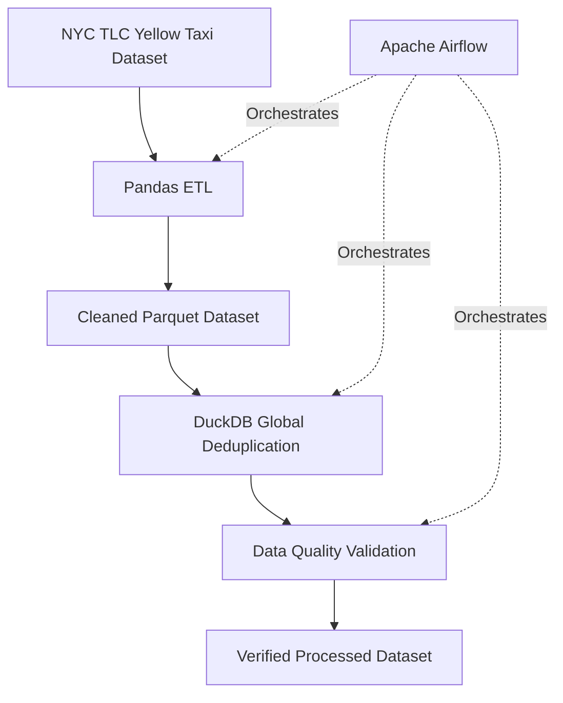

# NYC Taxi Data Engineering Pipeline 🚖

An end-to-end Data Engineering project that processes NYC Yellow Taxi trip data using **Pandas, PySpark, DuckDB, and Apache Airflow**. The pipeline performs data cleaning, global deduplication, and data quality validation while orchestrating the workflow through Airflow.

## 📌 Project Overview

This project demonstrates a practical data engineering workflow using a real-world NYC taxi dataset.

The pipeline:
- Reads NYC Yellow Taxi trip data in Parquet format.
- Cleans and transforms the raw dataset using Pandas.
- Processes data using PySpark for distributed processing.
- Performs global deduplication using DuckDB.
- Validates the processed dataset through automated checks.
- Orchestrates the ETL workflow using Apache Airflow.
- Stores cleaned data in Parquet format for downstream analytics.

## 🏗️ Architecture



## 🔄 Pipeline Workflow

The Apache Airflow DAG consists of three sequential tasks:

1. **Pandas ETL**
   - Reads raw Parquet data in batches.
   - Performs data cleaning and transformation.
   - Calculates trip duration.
   - Removes invalid records.
   - Writes cleaned data to Parquet.

2. **DuckDB Global Deduplication**
   - Performs global duplicate detection across the processed dataset.
   - Uses DuckDB to efficiently process Parquet data.
   - Produces the deduplicated dataset.

3. **Data Validation**
   - Checks raw and processed record counts.
   - Verifies duplicate records.
   - Checks invalid trip durations.
   - Checks negative trip distances.
   - Reports output dataset size.

The tasks execute sequentially:

`pandas_etl → global_deduplication → validate_data`

## 📊 Dataset

**Source:** NYC Taxi & Limousine Commission (TLC)

Dataset: January 2025 Yellow Taxi Trip Records

Official dataset source:  
https://www.nyc.gov/site/tlc/about/tlc-trip-record-data.page

| Attribute | Value |
|---|---|
| Dataset | January 2025 Yellow Taxi |
| Format | Parquet |
| Raw Records | 3,475,226 |
| Raw Columns | 20 |
| Processed Records | 3,473,175 |
| Processed Columns | 21 |

## 🛠️ Technologies Used

| Technology | Purpose |
|---|---|
| Python | ETL implementation |
| Pandas | Data cleaning and transformation |
| PySpark | Distributed data processing |
| DuckDB | Global deduplication and analytical processing |
| Apache Airflow | Workflow orchestration |
| PyArrow | Parquet processing |
| Docker | Containerized Airflow environment |
| SQL | Data analysis |
| Git & GitHub | Version control |

## 📁 Project Structure

```text
nyc-taxi-data-engineering/
│
├── airflow/
│   └── dags/
│       └── nyc_taxi_etl.py
│
├── dags/
│   └── nyc_taxi_etl.py
│
├── src/
│   ├── inspect_dataset.py
│   ├── profile_dataset.py
│   ├── etl_pipeline.py
│   ├── etl_pipeline_backup.py
│   ├── verify_etl.py
│   ├── pyspark_etl.py
│   ├── compare_etl.py
│   ├── global_deduplication.py
│   ├── run_sql.py
│   └── run_daily_analytics.py
│
├── sql/
│   ├── 01_basic_analytics.sql
│   └── 02_daily_analytics.sql
│
├── data/
│   ├── raw/
│   └── processed/
│
├── Dockerfile
├── docker-compose.yaml
├── .gitignore
└── README.md
```

## ⚙️ Setup and Execution

### 1. Clone the repository

```bash
git clone https://github.com/Shinde-Bharat/nyc-taxi-data-engineering.git
cd nyc-taxi-data-engineering
```

### 2. Create a Python virtual environment

```bash
python -m venv .venv
```

Activate the environment:

**Windows PowerShell**
```powershell
.\.venv\Scripts\Activate.ps1
```

Install dependencies:

```bash
pip install pandas pyarrow pyspark duckdb
```

### 3. Download the dataset

Download the January 2025 Yellow Taxi Parquet file from the official NYC TLC website.

Place it inside:

```text
data/raw/yellow_tripdata_2025-01.parquet
```

### 4. Run the ETL pipeline

```bash
python src/etl_pipeline.py
```

### 5. Run global deduplication

```bash
python src/global_deduplication.py
```

### 6. Verify the processed dataset

```bash
python src/verify_etl.py
```

### 7. Run Apache Airflow

Start the Airflow environment using Docker Compose:

```bash
docker compose up -d
```

Access the Airflow UI:

http://localhost:8081

Enable and trigger the DAG:

`nyc_taxi_etl_pipeline`

The pipeline automatically executes:

- `pandas_etl`
- `global_deduplication`
- `validate_data`

## ✅ Data Quality Results

Final verification results from the processed dataset:

| Validation | Result |
|---|---:|
| Raw Records | 3,475,226 |
| Processed Records | 3,473,175 |
| Records Removed | 2,051 |
| Processed Dataset Shape | 3,473,175 × 21 |
| Duplicate Records | 0 |
| Invalid Trip Duration | 0 |
| Negative Trip Distance | 0 |
| Output File Size | 75.06 MB |

**Verification Status: PASSED**

All three Apache Airflow tasks completed successfully.

## 📈 SQL Analytics

The project also includes SQL-based analytics:

- Basic taxi trip analytics.
- Daily trip analytics.
- Aggregated trip metrics.

SQL scripts are available in the `sql/` directory.

## 🚀 Future Enhancements

- AWS S3 for cloud data storage.
- AWS Athena for serverless SQL analytics.
- Power BI dashboard for interactive visualization.
- Cloud-based ETL orchestration.
- Automated monitoring and alerting.

## 👨‍💻 Author

**Bharat Shinde**

GitHub: [Shinde-Bharat](https://github.com/Shinde-Bharat)

Project Repository: [NYC Taxi Data Engineering](https://github.com/Shinde-Bharat/nyc-taxi-data-engineering)

---

⭐ If you find this project useful, consider giving it a star!
